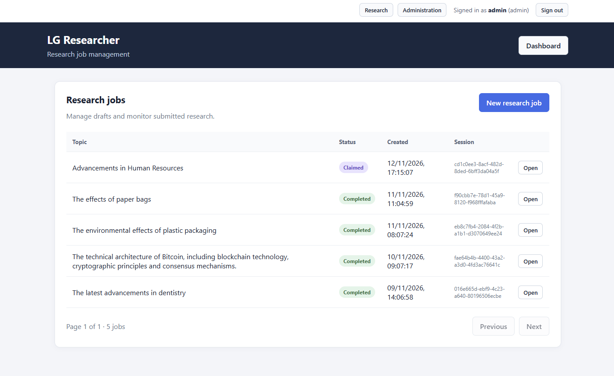

**LG Researcher**

LG Researcher is a langgraph based LLM agnostic research assistant.  Designed for enterprise-wide use case scenarios where many individuals or teams need to perform research on given topics.  Windows or Linux hosted, LG Researcher runs as a service in the background exposing a web UI, with individual account access, where individuals can describe their research in detail including the questions they would like answered.  The engine will then employ one or more LLMs to explore the web and produce a final written report.

**Installation Instructions**

Can be found in the root folder of the app in a file called 'DeploymentNotes.txt'  

    

**Some useful notes**

This application is still under development.  When a new push occurs to the repo, it is advisable to delete all tables in the DB and start fresh with 'python create_database.py'.  The application offers two primary providers of agents, Ollama (any model) and OpenAI (any model).  These models can be set in the .env file, a sample of which is provided in the 'DeploymentNotes.txt'. There are also two providers of search results DDGS (which can be unreliable and produce garbled reports) and LangSearch (go to langsearch.com to get an API key - its free).  In the .env file, there are settings which govern how many search results to perform and a number of other settings regarding word count.  In the 'DeploymentNotes.txt' file, the default settings are for very quick tests on small local models.  Play around with these values depending on the size of the context window you are targeting.  There is also a lexical text chunker which is useful for smaller models.  Set it to false for larger context windows.  
  
Search and agent providers are pluggable.  It is possible to add other sources for agents and search, which makes it useful for integration scenarios in research heavy industries such as the legal profession, advisory roles, etc.  Just wire it up to your own data and let it crunch.  

The quality of the reports has improved substantially since the first push of this software to Github.  But, it is still advised that, particularly with custom sources, that data cleaning is given priority.  The application does its best but, especially with small models (i.e. Qwen3 8B, etc), it can get confused when data quality is poor and the need for specialist knowledge is high.  
